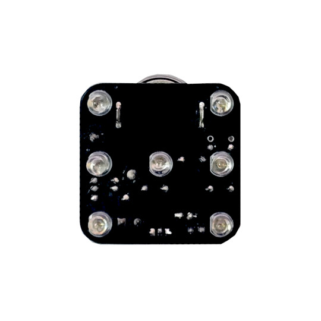
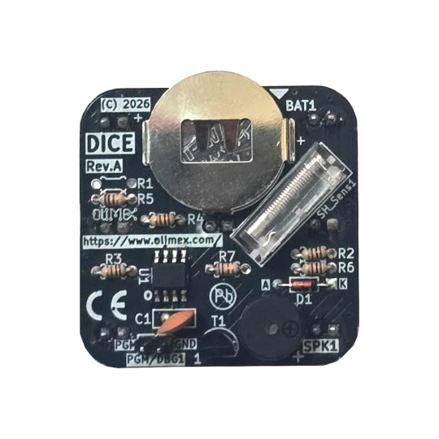
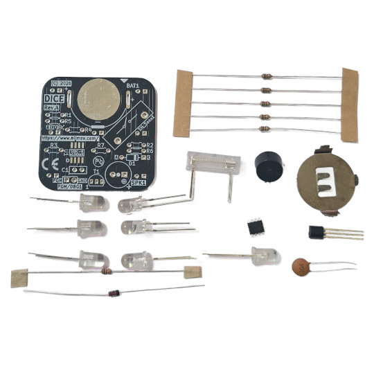

# SLD-KIT-DICE

Electronic dice soldering kit: shake it, and it spins with sound and lands on a random number.





- CH32V003J4M6 RISC-V microcontroller, 7 LEDs, shock sensor, speaker
- One CR2032 coin cell, ~6 µA in standby
- Through-hole parts only, except the SOP-8 microcontroller

Български: [README_BG.md](README_BG.md)

## Licensee
* Hardware is released under CERN Open Hardware Licence Version 2 - Strongly Reciprocal https://spdx.org/licenses/CERN-OHL-S-2.0.html
* Software is released under MIT Licensee
* Documentation is released under CC BY-SA 4.0 https://creativecommons.org/licenses/by-sa/4.0/

## Repository

| Folder | Content |
|---|---|
| [DOCUMENTS](DOCUMENTS) | [Soldering guide](DOCUMENTS/SLD-KIT-DICE_Soldering_Guide.pdf) and 2-page quick guide in [English](DOCUMENTS/SLD-KIT-DICE_Quick_Soldering_Guide.pdf) and [Bulgarian](DOCUMENTS/SLD-KIT-DICE_Quick_Soldering_Guide_BG.pdf) (PDF, and ODT to edit) |
| [HARDWARE/SLD-KIT-DICE_Rev_A](HARDWARE/SLD-KIT-DICE_Rev_A) | KiCad project, [schematic (PDF)](HARDWARE/SLD-KIT-DICE_Rev_A/SLD-KIT-DICE_Rev_A.pdf), [BOM](HARDWARE/SLD-KIT-DICE_Rev_A/SLD-KIT-DICE_Rev_A_BOM.csv), Gerber files, 3D models |
| [SOFTWARE/SLD-KIT-DICE_FW](SOFTWARE/SLD-KIT-DICE_FW) | Firmware source (ch32fun + PlatformIO) |
| [SOFTWARE/SLD-KIT-DICE_FW/firmware](SOFTWARE/SLD-KIT-DICE_FW/firmware) | Ready-to-flash images |

## Programming

Connect a WCH-LinkE to the PGM/DBG header: pin 1 = SWIO, pin 2 = GND. The header has no VCC, so the battery must be in. The chip accepts the programmer only in the first 3 s after the battery is put in: start the command, then put the battery in.

```bash
cd SOFTWARE/SLD-KIT-DICE_FW
until minichlink -w firmware/dice.bin 0x08000000 -b; do sleep 0.2; done
```

With PlatformIO (builds and flashes):

```bash
cd SOFTWARE/SLD-KIT-DICE_FW
until pio run -t upload; do sleep 0.2; done
```

How the firmware works, how to build it and how to debug it: [SOFTWARE/SLD-KIT-DICE_FW/README.md](SOFTWARE/SLD-KIT-DICE_FW/README.md).
