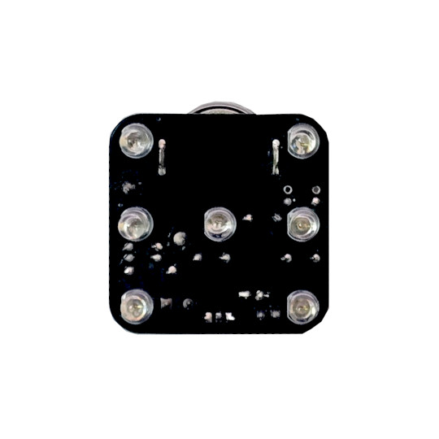
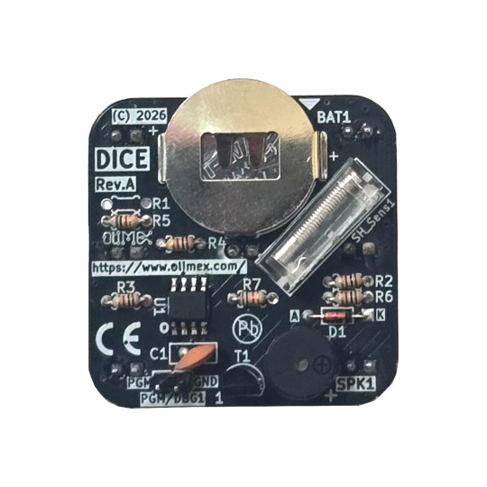
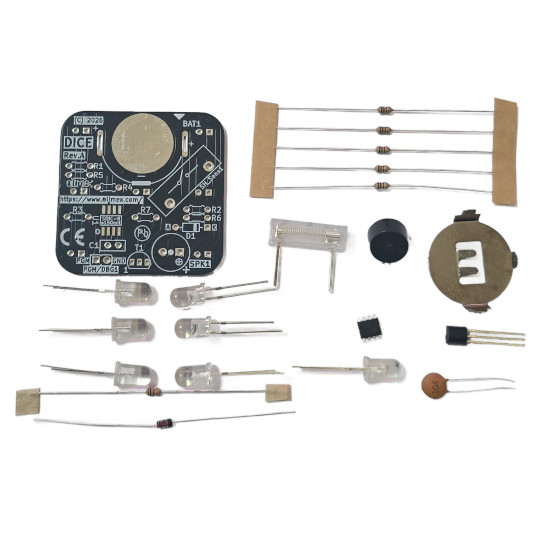

# SLD-KIT-DICE

Комплект за запояване на електронно зарче: разклащаш го, то се върти със звук и спира на случайно число.





- Микроконтролер CH32V003J4M6 (RISC-V), 7 светодиода, шоков датчик, говорител
- Една батерия CR2032, ~6 µA в сън
- Само елементи за монтаж в отвори, без микроконтролера SOP-8

English: [README.md](README.md)

## Лиценз
* Хардуерът е под CERN Open Hardware Licence Version 2 - Strongly Reciprocal https://spdx.org/licenses/CERN-OHL-S-2.0.html
* Софтуерът е под лиценз MIT
* Документацията е под CC BY-SA 4.0 https://creativecommons.org/licenses/by-sa/4.0/

## Хранилище

| Папка | Съдържание |
|---|---|
| [DOCUMENTS](DOCUMENTS) | [Ръководство за запояване](DOCUMENTS/SLD-KIT-DICE_Soldering_Guide.pdf) и кратко ръководство на 2 страници на [английски](DOCUMENTS/SLD-KIT-DICE_Quick_Soldering_Guide.pdf) и [български](DOCUMENTS/SLD-KIT-DICE_Quick_Soldering_Guide_BG.pdf) (PDF и ODT за редакция) |
| [HARDWARE/SLD-KIT-DICE_Rev_A](HARDWARE/SLD-KIT-DICE_Rev_A) | KiCad проект, [схема (PDF)](HARDWARE/SLD-KIT-DICE_Rev_A/SLD-KIT-DICE_Rev_A.pdf), [BOM](HARDWARE/SLD-KIT-DICE_Rev_A/SLD-KIT-DICE_Rev_A_BOM.csv), Gerber файлове, 3D модели |
| [SOFTWARE/SLD-KIT-DICE_FW](SOFTWARE/SLD-KIT-DICE_FW) | Изходен код на фърмуера (ch32fun + PlatformIO) |
| [SOFTWARE/SLD-KIT-DICE_FW/firmware](SOFTWARE/SLD-KIT-DICE_FW/firmware) | Готови файлове за запис |

## Програмиране

Свържи WCH-LinkE към конектора PGM/DBG: пин 1 = SWIO, пин 2 = GND. Конекторът няма VCC, затова батерията трябва да е поставена. Чипът приема програматора само в първите 3 s след поставяне на батерията: пусни командата и тогава постави батерията.

```bash
cd SOFTWARE/SLD-KIT-DICE_FW
until minichlink -w firmware/dice.bin 0x08000000 -b; do sleep 0.2; done
```

С PlatformIO (компилира и записва):

```bash
cd SOFTWARE/SLD-KIT-DICE_FW
until pio run -t upload; do sleep 0.2; done
```

Как работи фърмуерът, как се компилира и как се търсят проблеми: [SOFTWARE/SLD-KIT-DICE_FW/README_BG.md](SOFTWARE/SLD-KIT-DICE_FW/README_BG.md).
